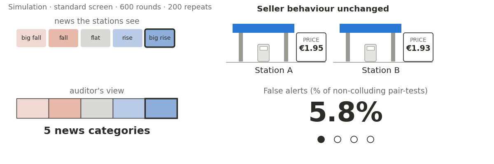
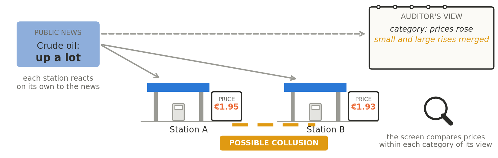

# Predicting False Collusion Alerts Under Incomplete Information

Evidence from a simulated market and an exploratory re-asking of LLM agents.

Edimah SYNESIUS SONGO. AI Collusion Research Sprint (Apart Research), 23–25 October 2026.



Less detailed information produces more false positives. An alert reflects the information used by the screen as well as what the agents did. The rates are measured false alerts as a share of non-colluding pair-tests (simulation, standard screen, 600 rounds, 200 repeats). The station prices are illustrative.

## Question

Collusion screens can mistake responses to shared information for collusion when auditors record less than sellers observe. In a simulated market with known ground truth, we predict and measure this failure.



The problem, in the paper’s running example. Both stations respond independently to detailed crude-oil news. The auditor’s view merges small and large rises into one category, ‘prices rose’. Across rounds in that category, the stations’ prices can still move together, so the screen can raise a false collusion alert.

## Results

- A standard conditional-independence screen wrongly flags 5.8% of non-colluding seller pairs with all five news levels, 51.7% with two recorded categories, and 100% with none. Model-based approximations closely predict these rates without fitting them.
- With two categories, increasing observations from 600 to 6,000 raises false positives to 100%. A stricter threshold delays but does not prevent the failure and can reduce detection of planted collusion.
- In an exploratory LLM-market pilot, a news-only screen flags seven of nine pairs in games without a planted private channel.
- We also test re-asking: querying each AI seller again on its recorded prompt, with the planted private instruction removed wherever present, to obtain comparison answers. The pre-registered binary statistic misses planted pairs, while a rank statistic chosen after inspecting the games detects the planted pair in all three planted games before correction for multiple testing.

More data can strengthen evidence of dependence without strengthening evidence of collusion.

## Limits

- We have not yet established whether re-asking gives reliable error rates when sellers respond to earlier rounds.
- We predict how often incomplete information causes false alerts, but do not claim to have validated a collusion detector.
- The simulated market uses binary prices and no memory. Its conclusions are not estimates for all real markets.

## Quick use

From the repository root, with Python 3:

```bash
pip install numpy scipy matplotlib
python sim.py --test        # self-checks of the detector
python theory.py            # self-checks, then predicted flag rates
python sim.py --debug       # 3 seeds, 100 rounds, about 6 s -> results/debug.csv
python figures.py           # redraws the simulation figures from the saved results
```

Full analysis commands: `python sim.py --all`, `python figures.py`, `python sensitivity.py`, `python llm/analyse.py`, `python llm/replay.py --rank`, and `python llm/table1.py`. `python sim.py --all` overwrites `results/`. `python docs/gifs/fuel_story.py` draws the GIF and Figures 1 and 3.

Reproducing LLM analyses that require original game logs also requires access to those logs. To create new games: `bash llm/setup.sh`, then `llm/run_pilot.sh` and `llm/run_c1.sh`. These need `ANTHROPIC_API_KEY` in `.env` and spend API credit. The pilot's whole-day spend was about $20.

## Repository

- `sim.py`: simulated market, standard test, ranking rule.
- `theory.py`: model-based predictions and the stricter BIC-based rule.
- `sensitivity.py`: Sobol indices of the predicted false-positive rate.
- `figures.py`: simulation figures.
- `llm/`: LLM pilot patch, run scripts, analyses, re-asking (`replay.py`), pre-registration (`PREREGISTRATION.md`).
- `results/`: saved results. Cached re-asked answers: `results/replay_draws.jsonl`, 7,128 answers. Raw game logs are not in the repository.
- `figures/`, `docs/gifs/`: figures and the GIF.

## Preexisting work

The LLM auction environment is adapted from Agrawal et al., commit `2bb2a7e`. The underlying information measures and testing tools also come from prior work cited in the report. Only the auction patch is shared because the upstream code has no licence.

## LLM usage

Claude Code implemented most of the simulation, LLM patch, re-asking and figure code under the author's decisions. Claude assisted with design review, checking results and citations, and explaining the methods. AI assisted with drafting and simplifying report prose and incorporating audit findings. The author is responsible for the final text, claims, citations and results.
